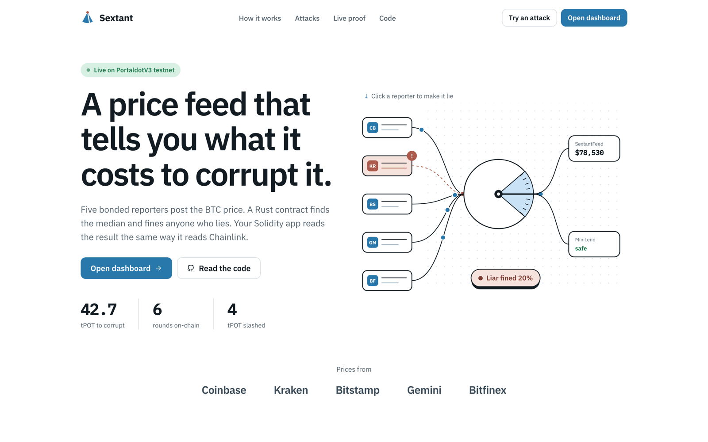
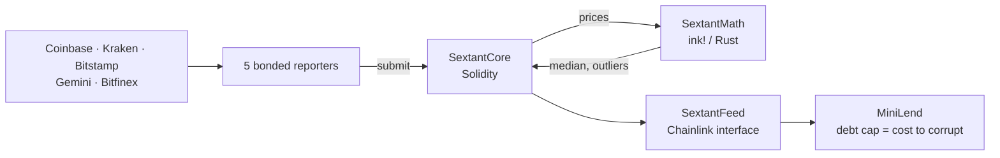
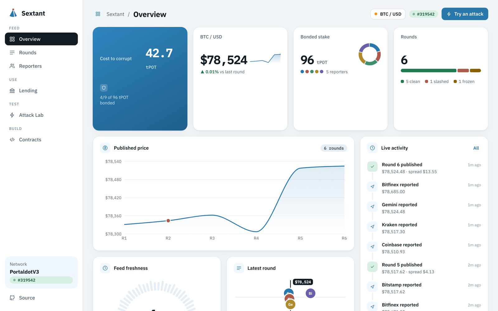
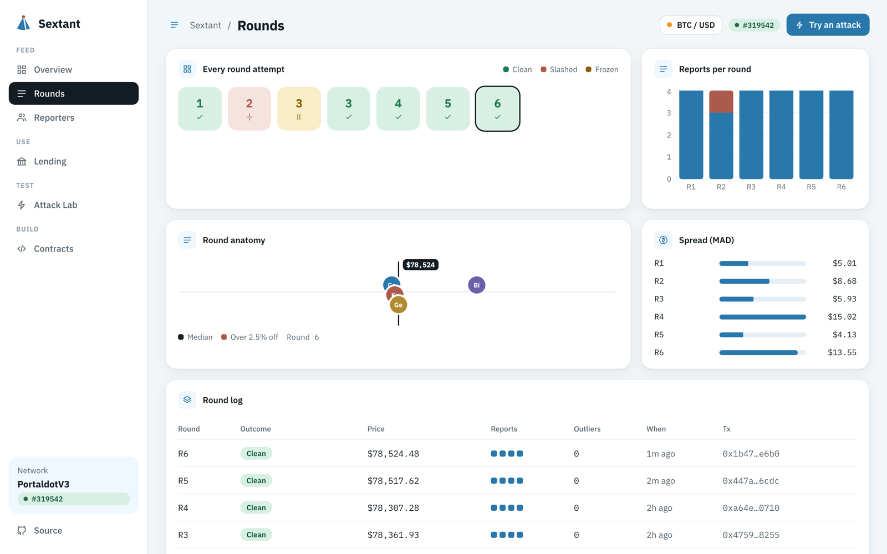
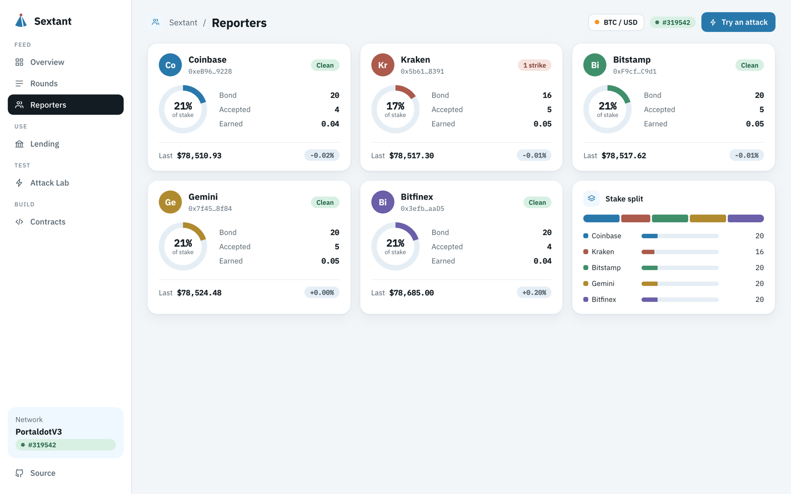
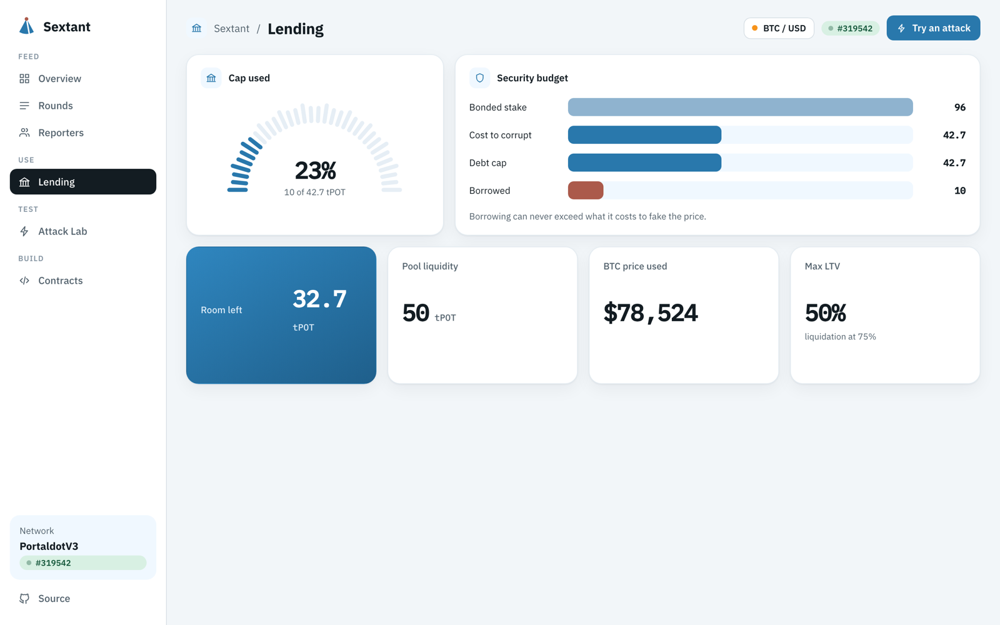
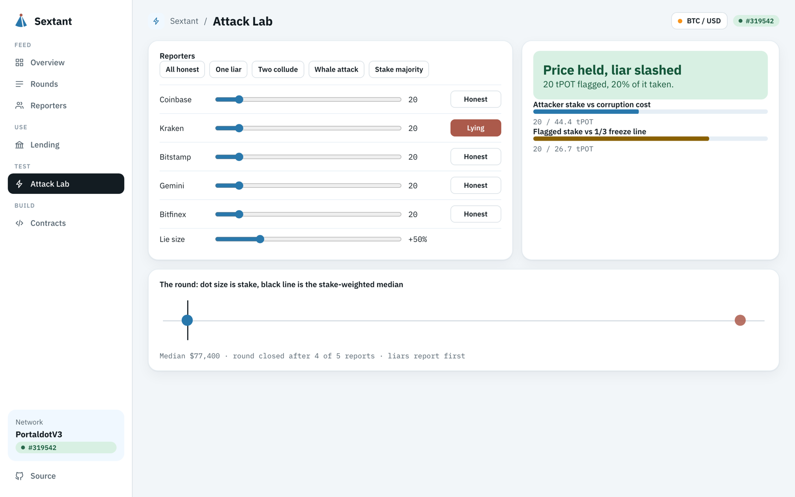
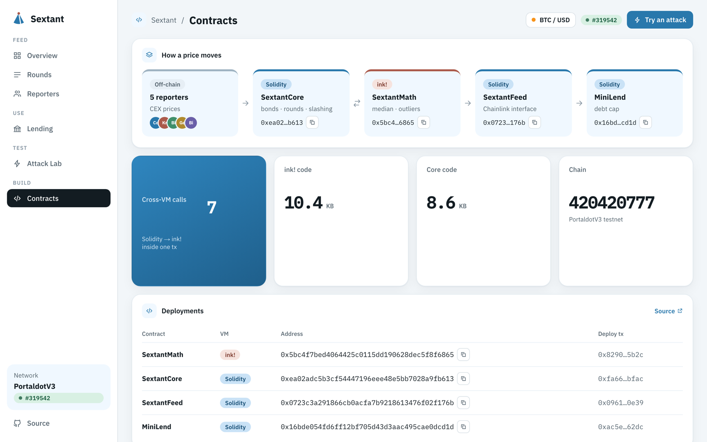

<p align="center">
  
</p>

<h1 align="center">Sextant</h1>

<p align="center">
  A price oracle for Portaldot that tells you what it costs to corrupt it.
</p>

<p align="center">
  <a href="https://sextant-oracle.vercel.app"><b>Live app</b></a> ·
  <a href="https://sextant-oracle.vercel.app/app">Dashboard</a> ·
  <a href="https://youtu.be/ix8gFLvdfJw">Demo video</a> ·
  <a href="docs/pitch-deck.pdf">Pitch deck</a> ·
  <a href="#live-rounds">On-chain proof</a>
</p>

<p align="center">
  
  
  
  
  
</p>

<p align="center">
  
</p>

## Contents

- [Why](#why)
- [How it works](#how-it-works)
- [What happens when someone lies](#what-happens-when-someone-lies)
- [Screenshots](#screenshots)
- [Run it](#run-it)
- [Deployments](#deployments)
- [Live rounds](#live-rounds)
- [Project layout](#project-layout)
- [Costs](#costs)
- [Known limits](#known-limits)
- [Roadmap](#roadmap)
- [License](#license)

## Why

A lending app trusts its price feed with every dollar in the pool. Most oracles can't tell you how much it would cost to push a fake price through them, so the app has no way to size its risk.

Sextant puts that number on-chain. `corruptionCost()` returns the stake an attacker would need, and the lending app caps its total debt at it. An attack costs more than it can steal.

## How it works



1. Five reporters bond tPOT and each post the BTC price from a different exchange.
2. `SextantCore` (Solidity) collects reports. Once 2/3 of the stake has reported, it calls `SextantMath` (ink!) in the same transaction.
3. `SextantMath` returns the stake-weighted median and flags any report more than 2.5% away that is also far outside the spread (MAD).
4. Core publishes the median, fines each flagged reporter 20% of their bond and pays the honest ones from the feed's pool.
5. `SextantFeed` exposes `latestRoundData()`, so existing Chainlink-reading Solidity code works unchanged.
6. `MiniLend` caps total debt at `corruptionCost()` and refuses prices older than 15 minutes.

Solidity and ink! both run on PortaldotV3's pallet-revive. Each closing submit is one transaction that crosses both VMs.

## What happens when someone lies

| Attack (5 equal reporters) | Result |
|---|---|
| 1 lies | The price holds. The liar loses 20% of their bond |
| 2 collude | Over 1/3 of the round disagrees, so the round freezes. Nothing is published and nobody is fined |
| 4/9 of all bonded stake | Can publish a false price |

A round closes at 2/3 of active stake and freezes if more than 1/3 of it is flagged. A false price needs 2/3 of 2/3 of the stake, which is 4/9. With 96 tPOT bonded today, that is 42.7 tPOT.

## Screenshots

| Overview | Rounds |
|---|---|
|  |  |
| **Reporters** | **Lending** |
|  |  |
| **Attack Lab** | **Contracts** |
|  |  |

Every number on the dashboard comes from the chain, refreshed every 12 seconds. The Attack Lab runs the contract's round rules in your browser so you can try an attack before it runs on-chain.

## Run it

You need Rust, `cargo-contract` 6.0.0-beta.2, Foundry, Node 22+ and pnpm. Put a testnet mnemonic in `.env` (see `.env.example`).

```bash
(cd contracts/math && cargo test && cargo contract build --release)
(cd contracts/evm && forge test && forge build)
cd scripts && pnpm install
npx tsx fund-evm.ts 2500
pnpm deploy && pnpm setup
pnpm reporter                     # honest reporters, 60s rounds
pnpm reporter --once --lie 2      # reporter 2 lies by 50%
pnpm reporter --once --lie 1,2    # two collude: the round freezes
npx tsx lend-demo.ts 60 10        # fund MiniLend with 60, borrow 10
npx tsx status.ts <tx>            # decode any transaction's events
cp ../deployments.json ../app/lib/deployments.json
cd ../app && pnpm install && pnpm dev
```

Tests: 9 Forge tests (liar, collusion, whale, unbonding, lending cap, TWAP) and 5 ink! unit tests.

## Deployments

PortaldotV3 testnet, chain ID 420420777, EVM RPC `https://test-evm-rpc-v3.portaldot.dev`.

| Contract | Address | Deploy tx |
|---|---|---|
| SextantMath (ink!) | `0x5bc4f7bed4064425c0115dd190628dec5f8f6865` | `0x82908ae49d21df90e0c9711532c5cce2a2349bd5e6ef4a5cf07912e8c92b5b2c` |
| SextantCore | `0xea02adc5b3cf54447196eee48e5bb7028a9fb613` | `0xfa660262b05a6551c4049304bf7969b5d63d1590e0b1d11624467451da0dbfac` |
| SextantFeed (BTC / USD) | `0x0723c3a291866cb0acfa7b9218613476f02f176b` | `0x0961f58a9d0f43608c83b3657b4a1ddbcc6174d532d6dd0811f51e8e56770e39` |
| MiniLend | `0x16bde054fd6ff12bf705d43d3aac495cae0dcd1d` | `0xac5e673500baa895006de24094bfa9bc8b5278124249606b661b5fd55b9262dc` |

### Live rounds

Every closing submit below is one transaction in which Solidity `SextantCore` calls ink! `SextantMath.aggregate` and acts on the result.

| Round | What happened | Closing tx | Result |
|---|---|---|---|
| 1 | 4 honest reports | `0x8a78b816d0f06154e40f9eb1799e0687e7a8898322568bf4d3df230a06d97ec3` | Published $78,331.13, MAD $5.01, 0 outliers |
| 2 | Reporter 2 reports $117,507 (+50%) | `0x8e6d12c0628b146923e4cbff0ea068ab0e6fd9bd763f9bb4aed05b389435456c` | Published $78,343.83. Liar slashed 4 tPOT (20% of bond) |
| 3 (attempt) | Reporters 1 and 2 collude at ~$117,500 | `0x7140b1e5fd7e6a3ec3838d2d511b063f01b4542a747d0425e09a10b761fb9c17` | `RoundContested`: 36 of 76 tPOT flagged (over 1/3). Nothing published, nobody slashed |
| 3 | Honest reports resume | `0x4759a1c9a172f07f61d775d0eb5726300c64e6b9053b38e8adcf2f406bd98255` | Published $78,361.93 |

Run `npx tsx scripts/status.ts <tx>` to decode the events of any of these.

### Setup transactions

- `createFeed`: `0x8703cebbfb79e962d90b5ab82524b533ffcaff6704163792ba10d2157de3734b`
- `fundFeed` (20 tPOT): `0x8dd61d29c60cd3e4c0d913f94b726bb2a07f3eed164fb2e4c07422455a7a05e1`
- `join` (20 tPOT bond each):
  - reporter 1 `0xc460f4429e949ea2f40e58574a78714b479f5eb755cd1e7e0e40ab2d5ab8d80e`
  - reporter 2 `0x01f6850f16afe6320ad54808eb4521449f207033a396789a2fededf36cd0b574`
  - reporter 3 `0x1bc15d061f490df477ae8cddd7359781b0fbd5df16939a5fa1c2540582df3e02`
  - reporter 4 `0x18d798dae55654aa1fb7ff7ab48598123fbc2878a0115e6e31c80381094c02c6`
  - reporter 5 `0x0e1ca974cddf3b5a53f6950e00dc03ae0fef1674570475a478c4ad15184fa7e2`

### Lending

- MiniLend funded with 60 tPOT. Deposit `0x62087787…85df4`, borrow of 10 tPOT `0x21f6c658…62d7`. Room left under the cap: 32.7 tPOT.

### v1

`docs/deployments.v1.json` is the first full deployment (blocks 266723–266727). It was abandoned because `aggregate` trapped: decoding two `uint128[16]` arrays overflowed the default contract stack. `min_stack_size!` in `contracts/math/lib.rs` fixes it. The v1 reporter bonds were withdrawn and reused.

## Project layout

```
contracts/math   ink! v6 SextantMath: median, MAD, outlier mask
contracts/evm    SextantCore, SextantFeed, MiniLend (Foundry)
contracts/core   First all-ink! core, kept for reference and not deployed
reporter         Exchange price sources
scripts          Fund, deploy, reporter setup, reporter node, lending demo, status
app              Next.js: landing page (/) and dashboard (/app)
docs             Pitch deck, screenshots, logo, submission text
```

## Costs

V3 charges about 0.08 tPOT per byte of deployed code. Reports use fixed-size `uint128[16]` arrays, which keeps the ink! contract allocation-free at 10.4 KB (SextantCore is 8.6 KB). Each submit needs about 24 tPOT available upfront (`scripts/topup.ts`), and a round costs a few tPOT in storage deposits. Deploying Core, Feed and MiniLend and creating the feed cost 997.8 tPOT in total.

## Known limits

- `guardianSlash` is owner-only. An attacker above 4/9 of stake is stopped by the unbonding delay plus this manual slash, so it should move to governance.
- Forge tests use `MathRef`, a Solidity port of the ink! maths. Only the on-chain run exercises the real cross-VM call.
- `MiniLend` uses synthetic BTC and a fixed 1 tPOT = 1 USD, because POT has no testnet market price.
- The Attack Lab runs a TypeScript port of the round rules in the browser. It's a simulator, and on-chain results are on the Overview and Reporters tabs.
- Public exchange APIs fail now and then. The reporter retries, and a round still closes with four of five reports.

## Roadmap

- **Dec 2026:** native Portaldot reporter accounts and permissionless joining
- **Q1 2027:** ETH, DOT and POT feeds, first partner integration
- **Q2 2027:** audit, then mainnet with an independent reporter set

## License

[Apache-2.0](LICENSE). Built by [Rohit Purkait](https://github.com/codeswithroh) for Portaldot Hacker House 2026.
